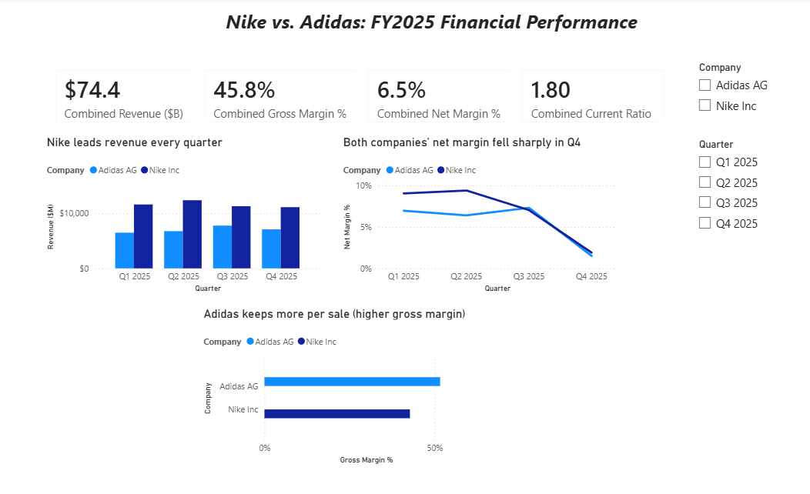
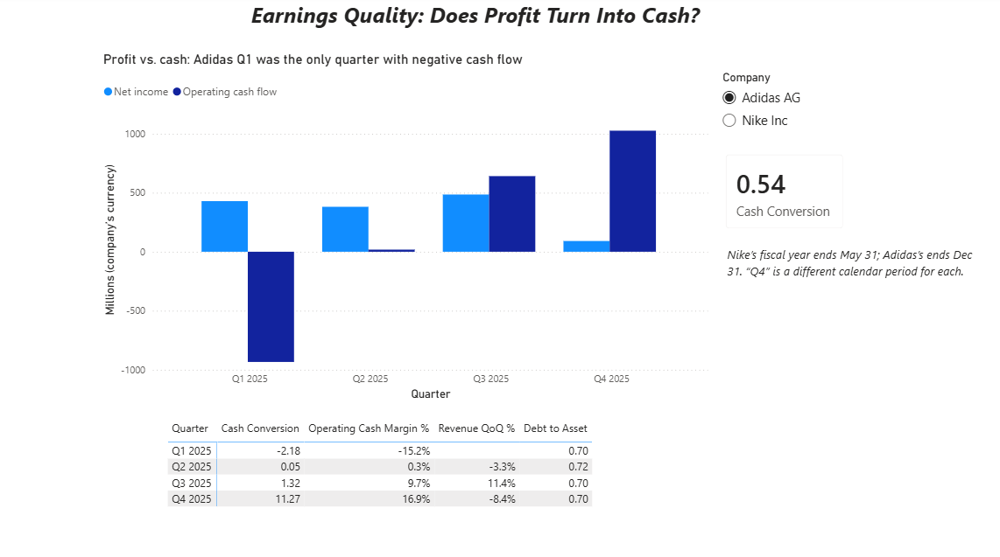

# Retail Financial Performance Analytics (SQL + Power BI)

A SQL analytics project comparing the quarterly financial performance of **Nike** and **Adidas** across fiscal year 2025. Raw financial data is stored in a normalized relational database, and analytical SQL queries turn it into finance KPIs — margins, liquidity, leverage, and cash-flow quality.

This project extends an earlier Excel dashboard comparing the same companies, rebuilt as a proper SQL database with version control, and adds an interactive **Power BI dashboard** on top of the same star schema.

## Business question

How do Nike and Adidas compare across fiscal year 2025 on profitability, liquidity, leverage, and the quality of their earnings (does reported profit turn into real cash)?

## Database design

The database uses a simple **star schema** — two dimension tables and one fact table, plus a small exchange-rate lookup table:

| Table | Type | Description |
|---|---|---|
| `companies` | Dimension | Company name, ticker, currency |
| `quarters` | Dimension | Fiscal year, quarter label |
| `financials` | Fact | One row per company per quarter: revenue, profit, assets, liabilities, cash flow |
| `fx_rates` | Lookup | Average USD exchange rate per currency per quarter, used to convert Adidas revenue to USD |

Tables are linked with **primary keys and foreign keys**, and `financials` uses a **composite primary key** (`company_id`, `quarter_id`) so each company can have only one row per quarter.

A view, `kpi_quarterly`, joins the tables, converts revenue to USD (`revenue_usd`), and calculates the finance ratios so the analysis queries stay clean.

## KPIs calculated

- **Gross / operating / net margin** — profitability
- **Current ratio** — short-term liquidity
- **Debt-to-asset** — leverage
- **Operating cash margin** and **cash-to-revenue** — cash strength
- **Cash conversion** (operating cash flow ÷ net income) — earnings quality

## SQL techniques used

- Multi-table `JOIN`s across a normalized schema
- A reusable **`VIEW`** for the KPI layer
- **CTEs** (`WITH`) to structure multi-step queries
- **Window functions**: `LAG` (quarter-over-quarter growth), `RANK` (revenue ranking), and `AVG OVER` (each quarter vs. the company's own average)

## Power BI dashboard

The same four tables are loaded into Power BI (`powerbi/nike_adidas_dashboard.pbix`) and the KPIs are rebuilt as **DAX measures**, so every number recalculates when a user filters by company or quarter.

### Page 1 — Performance Overview
KPI cards (revenue, gross margin, net margin, current ratio), revenue by quarter, net margin trend, and gross margin by company, with company and quarter slicers.

### Page 2 — Earnings Quality
Net income vs. operating cash flow by quarter, a cash conversion card, and a quarterly detail table (cash conversion, operating cash margin, revenue growth, debt-to-asset).

### How it's built
- **Data model:** star schema with `financials` as the fact table, related one-to-many to `companies` and `quarters`. `fx_rates` stays unrelated because its key has two columns; a `LOOKUPVALUE` calculated column converts Adidas revenue to USD instead.
- **DAX measures:** margins and cash conversion use `DIVIDE` on totals, so they stay correct at any filter level. Current ratio and debt-to-asset use `CALCULATE` to read only the latest quarter in view, because balance-sheet figures are snapshots and shouldn't be added across quarters. Quarter-over-quarter growth uses `REMOVEFILTERS` to compare against the previous quarter.
- **Validation:** dashboard values were checked against the SQL query results (e.g., Nike revenue $46.3B, Nike Q1 current ratio 2.36, Adidas Q1 cash conversion -2.18).

### How to open
Install the free [Power BI Desktop](https://powerbi.microsoft.com/desktop/) (Windows) and open `powerbi/nike_adidas_dashboard.pbix`. The source CSVs are in `powerbi/data/`.

## How to run the SQL

1. Open `retail.db` in [DB Browser for SQLite](https://sqlitebrowser.org/) (or any SQLite tool).
2. In the **Execute SQL** tab, run the scripts in the `/sql` folder in order:
   - `01_schema.sql` — creates the tables
   - `02_data.sql` — loads the data
   - `03_view.sql` — creates the KPI view
3. Open `04_analysis.sql` and run each query **one at a time** (highlight it, then Run) to see the results.

## Key findings

- **Nike leads on scale and liquidity, while Adidas keeps more profit per sale** — Nike ranks #1 on revenue ($46.3B vs. $28.0B after converting Adidas to USD), has a higher average net margin (6.8% vs. 5.5%), and a healthier current ratio (~2.2 vs. ~1.3). Adidas has the higher gross margin every quarter (~51–52% vs. Nike's 40–45%).
- **Each company had a sharp profitability drop in its own Q4** — net margin fell to roughly 2% for both, well below their own yearly averages. Because the fiscal years differ, these are different calendar periods, so this is each company's own cycle rather than one industry-wide event.
- **Adidas showed a Q1 cash-flow red flag** — it reported a profit (+429) but *burned* cash from operations (-934), a negative cash-conversion signal that net income alone would hide.

## Data sources

Quarterly figures are taken from Nike's and Adidas's investor relations websites for fiscal year 2025. For Nike, operating income uses the EBIT figure reported in its quarterly earnings releases. Adidas uses reported operating profit.

EUR-to-USD rates are quarterly averages of 2025 monthly average rates from [x-rates.com](https://www.x-rates.com/average/?from=EUR&to=USD&amount=1&year=2025).

## Things to know when reading the results

- **The fiscal years don't line up.** Nike's fiscal 2025 ended May 31, 2025. Adidas reports on the calendar year, ending December 31, 2025. So "Q4" means March-May for Nike and October-December for Adidas.

- **Currency.** Adidas reports in EUR, Nike in USD. The view converts revenue to USD at each quarter's average exchange rate, and the revenue ranking uses that converted figure. Margins and ratios need no conversion, because both numbers in each ratio are in the same currency. Quarter-over-quarter growth uses each company's own currency, so exchange-rate moves don't distort it.

---

*Built by Lasya Hari — Management Information Systems major, Finance minor, Drexel University.*
